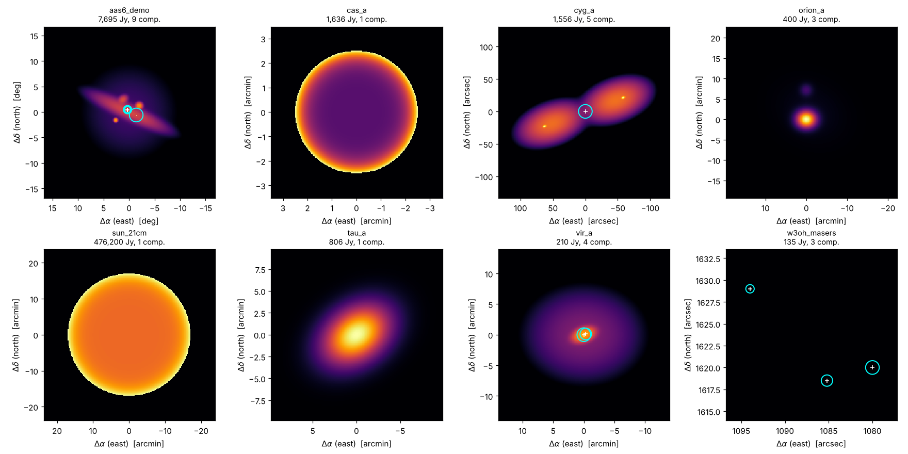

<!-- README.md -- Interferosim project overview -->
# Interferosim

An open-source simulator for radio interferometry — from a two-element
system up to small arrays — with interactive Jupyter notebooks for
teaching. A project of the University of Vienna.

Repository: <https://github.com/eschubi/interferosim> (private until the
licence questions are settled).

**Status:** 0.9.6 — sky models (`interferosim.sky`, notebook
`01_sky_models.ipynb` with a selector for all example skies),
instrument (`interferosim.instrument`: horn, parabolic dish and Yagi,
Ettus USRP B210 receiver, sites, stations and arrays; notebook
`02_instrument.ipynb`) and signal simulation (`interferosim.signal`:
IQ samples of every station from the sky model, instrument errors,
quantisation, SigMF output; notebook `03_signal_simulation.ipynb`) and
observation (`interferosim.observation`: uv-coverage, visibilities with
noise, transit of fixed antennas; data class `interferosim.visdata.VisData`;
notebook `04_observation.ipynb`) and the FX correlator
(`interferosim.signal.FXCorrelator` with delay/rate search; notebook
`05_correlator.ipynb`) and imaging (`interferosim.imaging`: gridding,
natural/uniform/Wiener weighting, dirty image and beam; notebook
`06_imaging.ipynb`) and deconvolution (`interferosim.deconvolution`:
Högbom CLEAN, clean beam and restoration, Wiener filter; notebook
`07_deconvolution.ipynb`) implemented, together with the first experiment:
the Sun with two horns on one B210 (`interferosim.observation.solar`;
notebook `08_sun_first_target.ipynb`), and spectral lines (spectra of the
sky components, Doppler correction to the LSR, multichannel visibilities,
channel maps; notebook `09_spectral_lines.ipynb`). The simulation chain
00–09 is complete; the theory notebooks A (fringes), B (Fourier
transformation and correlation), C (sampling and complex baseband), D
(noise and sensitivity) and E (coordinate frames) are available.

**Live demo:** `demo/interferometer_demo.html` – a self-contained page
(open it in any browser, no installation): a source above and to the right
of two antennas radiates with the flux density p at the frequency f; every
parameter is a slider and all panels follow in real time – wavefronts and
path difference, received wave trains, delay compensation, correlator and
complex visibility, fringe pattern over the direction, fringes over time
(Earth rotation, delay tracking, fringe stopping), sensitivity. Steps 1–7
guide a demonstration; English and German. The
further stages are being migrated from `aas6sim` and the teaching
notebooks step by step.

## Quick start

Create the project environment `.venv` (Python >= 3.11 required):

```
setup_venv.bat                 # Windows (double-click or command line)
./setup_venv.sh                # Linux / macOS
```

Then:

```
.venv\Scripts\activate          # Windows   (Linux/macOS: source .venv/bin/activate)
interferosim-hello             # prints: Hello, world!
interferosim-sky configs/skies/aas6_demo.json --overview -o demo.png
jupyter lab notebooks          # kernel "Python (interferosim)"
```

## Hello world

```python
from interferosim.hello import hello_world
print(hello_world("Interferosim"))
# Hello, Interferosim!
```

## Example skies

`configs/skies/` contains sky models in the JSON format of AAS6
(`json/interfero/sim_sky.json`, plus the component kind `disc`):

| File | Content | S (1.42 GHz) |
|---|---|---|
| `aas6_demo.json` | demo field of `aas6sim` around W3(OH) | 7695 Jy |
| `w3oh_masers.json` | the three OH masers of the demo field | 135 Jy |
| `sun_21cm.json` | quiet Sun, limb-brightened disc 34′ | 476 kJy |
| `cas_a.json` | Cassiopeia A, supernova remnant | 1636 Jy |
| `cyg_a.json` | Cygnus A, radio galaxy (lobes, hotspots, core) | 1556 Jy |
| `tau_a.json` | Taurus A (Crab Nebula) | 806 Jy |
| `vir_a.json` | Virgo A (M87): core, jet, inner lobes, halo | 210 Jy |
| `orion_a.json` | Orion A (M42), approximate model | ~400 Jy |

Flux densities of Cas A, Cyg A, Tau A and Vir A follow Perley & Butler
(2017, ApJS 230, 7); Cas A and Tau A are corrected for their secular fading
to epoch 2026. Each file documents sources and simplifications in `_note`.
In notebook 01, section 6, a selector shows each sky as map, overview or
visibility amplitude over the baseline;
`interferosim.plotting.plot_sky_gallery()` draws all of them side by side.



## Instrument

```python
from interferosim.instrument import Antenna, Receiver, Array
dish = Antenna.from_toml("configs/antennas/dish_3m.toml")
b210 = Receiver.from_toml("configs/receivers/b210.toml")
arr  = Array.from_toml("configs/sites/aas6_sim_stations.toml")   # site, dishes, B210
b210.sefd_jy(dish), arr.baselines_enu(), b210.baseline_sigma_jy(dish, dish, 10.0)
```

Antennas: `horn_15dbi`, `dish_3m`, `yagi` (typical example values);
arrays: `aas6_sim_stations` (two 3 m dishes, 11.1 km east-west) and
`two_horns_10m` (notebook B).

## Notebooks

Teaching notebooks in `notebooks/`, one per topic, each with an
interactive selector (ipywidgets):

### Simulation chain

| Notebook | Content | Status |
|---|---|---|
| `00_general.ipynb` | project overview: goal of a VLB interferometer with an 11.5 km baseline (Wilhelmsburg–Michelbach), principle, key figures (resolution, delay, fringe rate, data rate), clock and timing requirements, sensitivity, road map | available |
| `01_sky_models.ipynb` | sky models, file format, maps, own skies, visibilities, catalogue of known regions with selector | available |
| `02_instrument.ipynb` | antenna types and primary beams, dish transfer function, B210 receiver and sensitivity, arrays and baselines, choice of the baseline length (Cyg A), selector | available |
| `03_signal_simulation.ipynb` | generating SDR receiver signals (IQ samples of the B210 at each station) based on the sky model under variable baseline parameters: signal model, raw fringes, measured vs. model visibilities over the baseline length, clock errors (TCXO/GPSDO), quantisation, SigMF output, selector | available |
| `04_observation.ipynb` | source tracking, geometric delay and fringe rate, uv-tracks by Earth rotation, visibilities over a track, transit (drift scan) of fixed antennas (Sun with two horns), asymmetry of a track, selector | available |
| `05_correlator.ipynb` | FX correlator on the simulated SDR signals: fractional delay, fringe stopping, delay/rate search and refinement, cross spectra, visibilities; station clock and LO offsets; selector | available |
| `06_imaging.ipynb` | gridding, natural/uniform/Wiener weighting, dirty beam and dirty image: OH masers with the project baseline and three stations, Cygnus A, selector | available |
| `07_deconvolution.ipynb` | Högbom CLEAN vs. Wiener filter, restoration (migrated from Appendix A) | proposal |
| `08_sun_first_target.ipynb` | the Sun with two horns on one B210: transit, fringes, disc visibility (migrated from Appendix B) | proposal |
| `09_spectral_lines.ipynb` | multichannel spectra: HI 21 cm and the OH maser lines, Doppler/LSR velocity, line visibilities per channel | proposal |

### Theory

| Notebook | Content | Status |
|---|---|---|
| `A_fringes.ipynb` | shows and explains how fringes evolve: fringe pattern on the sky, fringe rate from the Earth's rotation, effect of the source size (fringe contrast), fringes in a long track (Cygnus A with zooms of 5–20 min, natural and structure fringe rate), selector | available (first version) |
| `B_fourier.ipynb` | explains the details of the Fourier transformation and the correlation (van Cittert–Zernike theorem, cross-correlation vs. cross spectrum, FX vs. XF) | planned |
| `C_sampling_iq.ipynb` | sampling and complex baseband: Nyquist, IQ mixing, aliasing, quantisation, what the B210 delivers | proposal |
| `D_noise_sensitivity.ipynb` | radiometer equation, SEFD, noise of a visibility, S/N against integration time, bandwidth and baseline length | proposal |
| `E_coordinates.ipynb` | coordinate frames: equatorial, horizontal, WGS84/ECEF, local east-north-up, uvw | proposal |

*available*: in the repository; *planned*: decided, not yet written;
*proposal*: suggestion for discussion. The former Appendices A (Wiener
filter vs. CLEAN) and B (the Sun) of the teaching material become the
numbered notebooks 07 and 08, so that the letters A, B, C, … are free for
the theory notebooks.

## Processing chain

| Stage | Package module |
|---|---|
| Sky models (point, extended, HI 21 cm, OH masers, solar disc) | `interferosim.sky` |
| Antennas (selectable types), receiver (Ettus USRP B210), array | `interferosim.instrument` |
| Geometry, uv-coverage, visibilities, correlator | `interferosim.observation` |
| Gridding, weighting, dirty image and beam | `interferosim.imaging` |
| Högbom-CLEAN, Wiener filter, restoration | `interferosim.deconvolution` |
| FITS input/output | `interferosim.io` |

## Repository layout

```
src/interferosim/   Python package (core, independent of the user interface)
configs/            antenna types, receivers, sites (TOML)
notebooks/          one notebook per topic
tests/              pytest and nbval
binder/             environment for Binder / JupyterHub
docs/               LaTeX documentation (build: cd docs && latexmk)
docs/sphinx/        Sphinx documentation (build: build_sphinx_docs.bat)
```

## Installation (development, without the scripts)

```
python -m venv .venv
.venv\Scripts\python -m pip install -e ".[notebooks,test]"
.venv\Scripts\python -m pytest
```

Requires Python >= 3.11.

## Documentation (Sphinx)

User guide (the interferometer in brief, installation, sky models,
instrument, notebooks) and API reference from the docstrings:

```
.venv\Scripts\python -m pip install -e ".[docs]"
build_sphinx_docs.bat               # -> docs/sphinx/_build/html/index.html
```

## API documentation (Doxygen)

The source code documentation is also generated with Doxygen
(<https://www.doxygen.nl>):

```
doxygen Doxyfile                    # -> docs/api/html/index.html
```

On Windows `build_api_docs.bat` does everything, including the
installation of Doxygen with winget.

## Licence

Creative Commons Attribution 4.0 International (CC BY 4.0), see `LICENSE`.

## Author

DI Erich Schubert, 07925151
