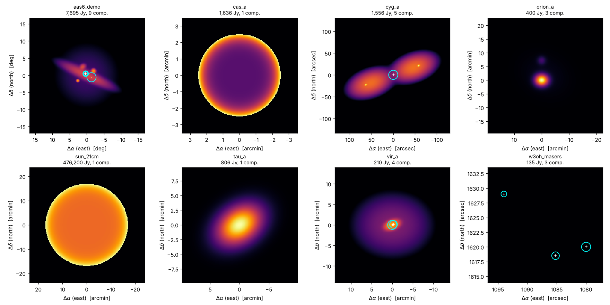

.. docs/sphinx/index.rst -- start page of the Interferosim documentation

Interferosim
============

An open-source simulator for radio interferometry -- from a two-element
system up to small arrays -- with interactive Jupyter notebooks for
teaching. A project of the University of Vienna.

**Status:** |release| -- sky models (:mod:`interferosim.sky`), the
instrument (:mod:`interferosim.instrument`: antennas, receiver, array) and
the signal simulation (:mod:`interferosim.signal`: IQ samples of every
station) are implemented; observation, imaging and deconvolution are being
migrated from
``aas6sim`` and the teaching notebooks step by step.

.. toctree::
   :maxdepth: 2
   :caption: User guide

   interferometer
   installation
   quickstart
   sky
   instrument
   notebooks

.. toctree::
   :maxdepth: 2
   :caption: Reference

   api
   changelog

Indices
-------

* :ref:`genindex`
* :ref:`modindex`
