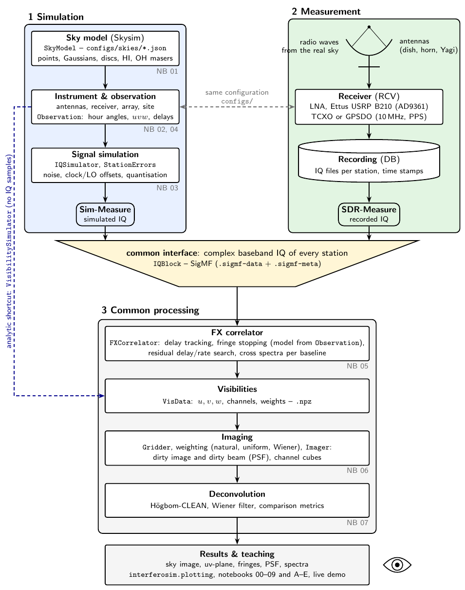
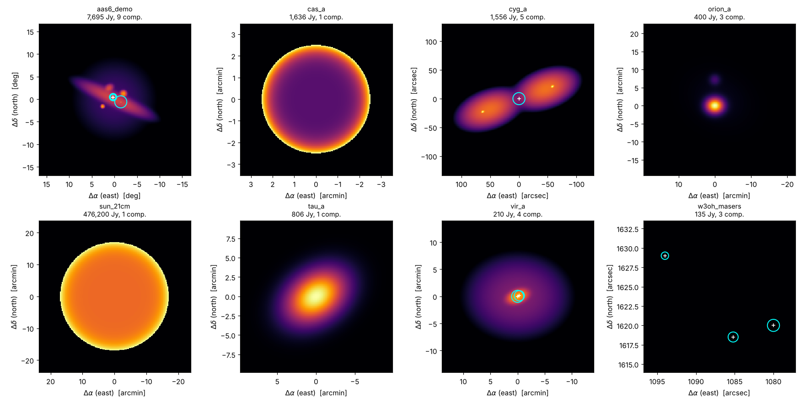

.. docs/sphinx/index.rst -- start page of the Interferosim documentation
.. 2026-11-16: chapter "Introduction and workflow" (introduction.rst) added to the user guide;
   workflow figure as overview at the beginning; status paragraph brought up to date

Interferosim
============

An open-source simulator for radio interferometry -- from a two-element
system up to small arrays -- with interactive Jupyter notebooks for
teaching. A project of the University of Vienna.

Overview
--------

Interferosim follows the signal from the sky to the image. A simulated
observation (branch 1) and a real measurement with SDR receivers (branch 2)
both deliver IQ samples of every station; from there on correlation,
imaging and deconvolution are the same (block 3). The chapter
:doc:`introduction` explains each step.

         IQ interface, correlator, visibilities, imaging, deconvolution
   :width: 70%
   :align: center
   :target: introduction.html

   The Interferosim workflow (click for the introduction chapter).

**Status:** |release| -- the complete simulation chain is implemented:
sky models with spectra (:mod:`interferosim.sky`), the instrument
(:mod:`interferosim.instrument`: antennas, receiver, array), the observation
(:mod:`interferosim.observation`: uv-coverage, analytic visibilities,
transit, Sun and spectral lines), the signal simulation and the FX correlator
(:mod:`interferosim.signal`), imaging (:mod:`interferosim.imaging`),
deconvolution with Högbom-CLEAN and Wiener filter
(:mod:`interferosim.deconvolution`) and the plots
(:mod:`interferosim.plotting`). The teaching notebooks 00--09 and A--E are
available (:doc:`notebooks`). Still open: the input/output package
:mod:`interferosim.io` (FITS, UVFITS, reading real B210 recordings) and the
ipywidgets front end :mod:`interferosim.widgets`.

.. toctree::
   :maxdepth: 2
   :caption: User guide

   introduction
   interferometer
   installation
   quickstart
   sky
   instrument
   notebooks

.. toctree::
   :maxdepth: 2
   :caption: Reference

   api
   changelog

Indices
-------

* :ref:`genindex`
* :ref:`modindex`
