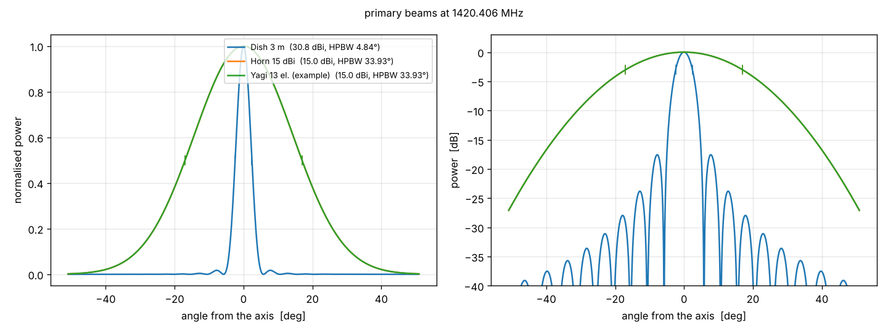

.. docs/sphinx/instrument.rst -- instrument: antennas, receiver, array

Instrument
==========

The package :mod:`interferosim.instrument` describes the hardware: antenna
types, the receiver and the array of stations. All parts are read from TOML
files in ``configs/``.

Antennas
--------

All antennas derive from :class:`~interferosim.instrument.Antenna` and
provide gain, effective area, half-power beam width (HPBW) and the
normalised power pattern (primary beam) as functions of the frequency.

.. list-table::
   :header-rows: 1
   :widths: 25 25 50

   * - Class
     - Config
     - Model
   * - :class:`~interferosim.instrument.ParabolicDish`
     - ``dish_3m.toml``
     - 3 m, aperture efficiency 0.60, HPBW = 1.20 λ/D, Airy beam
   * - :class:`~interferosim.instrument.Horn`
     - ``horn_15dbi.toml``
     - 15 dBi, Gaussian main lobe from the gain
   * - :class:`~interferosim.instrument.Yagi`
     - ``yagi.toml``
     - 13 elements, 15 dBi (typical example values)

Relations used:

.. math::

   A_\mathrm{eff} = \frac{G \lambda^2}{4 \pi}, \qquad
   \mathrm{HPBW} = \sqrt{\frac{4 \pi}{1.133\, G}} \quad \text{(Gaussian main lobe)}

.. code-block:: toml

   # configs/antennas/dish_3m.toml
   name = "Dish 3 m"
   type = "dish"
   diameter_m = 3.0
   aperture_efficiency = 0.60
   beam_factor = 1.20      # HPBW = beam_factor * lambda / D

   Primary beams of the antenna types at 21 cm
   (:func:`~interferosim.plotting.plot_beams`).

Receiver
--------

:class:`~interferosim.instrument.Receiver` carries the device profile of the
Ettus USRP B210 (two coherent RX channels, 2 MS/s, T\ :sub:`sys` = 120 K).
Together with an antenna it gives the SEFD and the radiometer noise of a
single dish or a baseline (see :doc:`interferometer`).

.. code-block:: python

   from interferosim.instrument import Antenna, Receiver
   dish = Antenna.from_toml("configs/antennas/dish_3m.toml")
   b210 = Receiver.from_toml("configs/receivers/b210.toml")
   b210.sefd_jy(dish), b210.single_dish_sigma_jy(dish, 1.0)

Sites, stations and arrays
--------------------------

:class:`~interferosim.instrument.Site` is the geodetic reference (WGS84),
:class:`~interferosim.instrument.Station` one antenna at a position and
:class:`~interferosim.instrument.Array` combines site, stations and receiver.
Baselines are given in the earth-fixed frame (ECEF) and in the local frame
(east, north, up); for baseline *i*--*j*, B = r\ :sub:`j` − r\ :sub:`i`.

A station is given geodetically (``latitude_deg``, ``longitude_deg``,
``height_m``) or as offset from the site (``east_m``, ``north_m``,
``up_m``). ``site``, ``antenna`` and ``receiver`` name files in
``configs/`` (without ``.toml``):

.. code-block:: toml

   # configs/sites/aas6_sim_stations.toml
   name = "AAS6 simulation, two stations"
   reference = "A"
   site = "wilhelmsburg"
   antenna = "dish_3m"
   receiver = "b210"

   [stations.A]
   latitude_deg = 48.088056
   longitude_deg = 15.756111
   height_m = 470.0

   [stations.B]
   latitude_deg = 48.088056
   longitude_deg = 15.905
   height_m = 470.0

Provided arrays: ``aas6_sim_stations`` (two 3 m dishes, 11.1 km east-west)
and ``two_horns_10m`` (notebook B).
