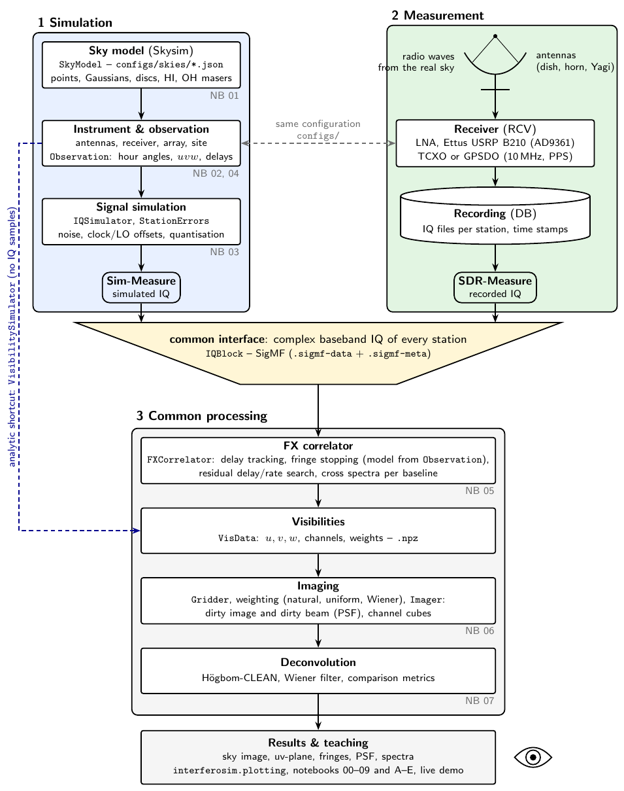

.. docs/sphinx/introduction.rst -- introduction: the Interferosim workflow (Version 0.1.0, 2026-11-16)

Introduction and workflow
=========================

Interferosim follows a radio signal from the sky to the final image. The
same processing chain serves two purposes:

* **Simulation** -- a sky model is "observed" with a model instrument. In
  this way students see how antenna placement, baseline length, bandwidth or
  receiver errors change the image, before any hardware exists.
* **Measurement** -- the real antennas and receivers of an interferometer
  (goal of the project: a VLB interferometer with an 11.5 km baseline
  Wilhelmsburg--Michelbach) record IQ samples, which go through exactly the
  same correlation and imaging steps.

The key point of the design is that both branches deliver *the same kind of
data*: complex baseband IQ samples of every station. From there on the
processing does not know -- and need not know -- whether the samples were
simulated or recorded. A simulated observation is therefore a direct test
case for the real one.

         a common IQ interface, followed by correlator, visibilities, imaging
         and deconvolution
   :width: 100%

   The Interferosim workflow. Branch 1 (simulation, "Sim-Measure") and
   branch 2 (measurement, "SDR-Measure") both produce IQ streams per
   station. After the common interface, correlation, imaging and
   deconvolution are identical for both (block 3). Dashed: the shared
   configuration of the hardware and the analytic shortcut without IQ
   samples. "NB" gives the teaching notebook that covers each step.

1 Simulation branch ("Sim-Measure")
-----------------------------------

**Sky model.** :class:`~interferosim.sky.SkyModel` describes the sky as a
set of components -- point sources, Gaussians, discs -- with spectra
(continuum, HI 21 cm line, OH masers). Models are JSON files in
``configs/skies/`` (format of the AAS6 file ``sim_sky.json``). Each model
provides its visibility analytically. See :doc:`sky`.

**Instrument and observation.** The package :mod:`interferosim.instrument`
describes antennas (:class:`~interferosim.instrument.ParabolicDish`,
:class:`~interferosim.instrument.Horn`, :class:`~interferosim.instrument.Yagi`),
the receiver (:class:`~interferosim.instrument.Receiver`, Ettus USRP B210)
and the array of stations at a site (:class:`~interferosim.instrument.Array`),
all read from TOML files in ``configs/antennas/``, ``configs/receivers/`` and
``configs/sites/``. :class:`~interferosim.observation.Observation` adds the
pointing and time range: hour angles, elevations, :math:`(u, v, w)` per
baseline, geometric delays and fringe rates. See :doc:`instrument`.

**Signal simulation.** :class:`~interferosim.signal.IQSimulator` computes the
IQ samples each SDR would record: the delayed sky signal weighted with the
primary beam, plus receiver noise. :class:`~interferosim.signal.StationErrors`
adds what a real system brings along -- clock and LO offsets, and with
:func:`~interferosim.signal.quantize` the quantisation of the ADC. The result
is one :class:`~interferosim.signal.IQBlock` per station.

2 Measurement branch ("SDR-Measure")
------------------------------------

**Antenna and receiver (RCV).** Each station consists of an antenna, a
low-noise amplifier and an Ettus USRP B210. The B210 mixes the signal to
complex baseband and samples it; a TCXO or, for long baselines, a GPSDO
(10 MHz and PPS) provides frequency reference and time stamps. The receiver
is described by the same configuration files as in the simulation branch
(dashed arrow), so model and hardware cannot drift apart.

**Recording (DB).** The host PC stores the IQ stream of each station with
its time stamps. For a VLB baseline the stations record independently; the
streams are brought together only for the correlation.

.. note::

   Reading real B210 recordings into :class:`~interferosim.signal.IQBlock`
   objects is part of the input/output package :mod:`interferosim.io`, which
   is still being migrated. Until then, the measurement branch is exercised
   with simulated recordings that contain the same instrument errors
   (clock and LO offsets, quantisation).

The common interface
--------------------

Both branches end in the same data structure: a dictionary of
:class:`~interferosim.signal.IQBlock` objects, one per station, with complex
samples, sample rate, centre frequency and start time.
:meth:`IQBlock.save_sigmf() <interferosim.signal.IQBlock.save_sigmf>` writes
a block in the open SigMF format (``.sigmf-data`` with complex float32
samples, ``.sigmf-meta`` with the metadata as JSON), so that simulated data
can be inspected with the same tools as recorded data.

3 Common processing
-------------------

**FX correlator.** :class:`~interferosim.signal.FXCorrelator` removes the
geometric delay and the fringe phase predicted by the observation model
(delay tracking, fringe stopping), searches the residual delay and fringe
rate per station (unknown clock and LO offsets), and averages the cross
spectra :math:`X_i X_j^*` of every baseline over the integration time.

**Visibilities.** The correlator output is a
:class:`~interferosim.visdata.VisData` set: one row per integration and
baseline with :math:`(u, v, w)`, the complex visibility per frequency channel
and its weight. It can be stored as ``.npz``.

**Imaging.** :class:`~interferosim.imaging.Gridder` puts the visibilities on
a regular uv-grid, a weighting scheme (natural, uniform, Wiener) is applied,
and :class:`~interferosim.imaging.Imager` computes the dirty image and the
dirty beam (point spread function) -- for spectral lines also one image per
channel.

**Deconvolution.** The dirty image is the true sky convolved with the dirty
beam. :class:`~interferosim.deconvolution.HogbomClean` and
:class:`~interferosim.deconvolution.WienerFilter` reconstruct the sky; error
metrics compare the result with the known input model -- possible only in a
simulation, and one of its main teaching benefits.

The analytic shortcut
---------------------

Simulating IQ samples is expensive: a few seconds of data at MHz sample rates
already fill memory. For many teaching questions -- uv-coverage, resolution,
weighting, deconvolution -- the sampling details do not matter.
:class:`~interferosim.observation.VisibilitySimulator` therefore computes the
visibilities directly from the analytic sky model, with radiometer noise, and
hands a :class:`~interferosim.visdata.VisData` set straight to the imaging
step (dashed blue path in the figure). Both paths deliver the same data class,
so they can be compared one to one.

Results and teaching
--------------------

Every step can be visualised with :mod:`interferosim.plotting` (sky map,
array layout, uv-plane, fringes, PSF, images, spectra). The teaching
notebooks follow the workflow from top to bottom:

.. list-table::
   :header-rows: 1
   :widths: 30 70

   * - Step of the workflow
     - Notebook
   * - Overview
     - ``00_general.ipynb``
   * - Sky model
     - ``01_sky_models.ipynb``
   * - Instrument
     - ``02_instrument.ipynb``
   * - Signal simulation
     - ``03_signal_simulation.ipynb``
   * - Observation, uv-coverage
     - ``04_observation.ipynb``
   * - FX correlator
     - ``05_correlator.ipynb``
   * - Imaging
     - ``06_imaging.ipynb``
   * - Deconvolution
     - ``07_deconvolution.ipynb``
   * - Applications
     - ``08_sun_first_target.ipynb``, ``09_spectral_lines.ipynb``
   * - Theory (fringes, Fourier, sampling, noise, coordinates)
     - ``A_fringes.ipynb`` to ``E_coordinates.ipynb``

The next chapter, :doc:`interferometer`, summarises the physics behind the
chain; :doc:`installation` and :doc:`quickstart` get you running.

.. Figure source: docs/images/workflow.tex (TikZ). Rebuild with
   pdflatex workflow.tex  and  pdftoppm -r 160 -png -singlefile workflow.pdf workflow
