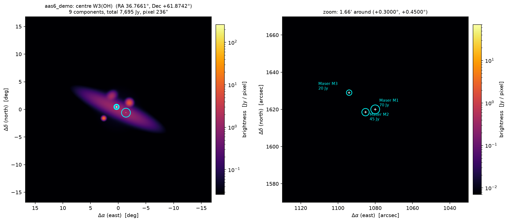

.. docs/sphinx/sky.rst -- sky models

Sky models
==========

A :class:`~interferosim.sky.SkyModel` is a field centre plus a list of
components. Each component knows its position, its flux density, how it is
rendered onto a pixel grid and its analytic visibility.

Component kinds
---------------

.. list-table::
   :header-rows: 1
   :widths: 15 30 55

   * - ``kind``
     - Class
     - Use
   * - ``point``
     - :class:`~interferosim.sky.PointSource`
     - masers, compact cores, hotspots
   * - ``gauss``
     - :class:`~interferosim.sky.GaussianSource`
     - extended emission, HI clouds, lobes (elliptical, with position angle)
   * - ``disc``
     - :class:`~interferosim.sky.DiscSource`
     - uniform or limb-brightened disc, e.g. the Sun at 21 cm

Conventions: ``dx_deg``/``dy_deg`` are the offsets from the field centre in
degrees (east, north); ``flux_jy`` is the total flux density in Jy; rendered
images are in Jy per pixel; ``u``, ``v`` are in wavelengths. In plots east is
to the **left** (astronomical convention).

File format
-----------

Sky models are stored in the JSON format of AAS6
(``json/interfero/sim_sky.json``); Interferosim adds the kind ``disc``
(fields ``diameter_deg``, ``limb``, ``limb_power``):

.. code-block:: json

   {
     "_note": "free text",
     "center": {"label": "W3(OH)", "ra_deg": 36.7661, "dec_deg": 61.8742},
     "components": [
       {"name": "Maser M1", "dx_deg": 0.3, "dy_deg": 0.45, "flux_jy": 70.0,
        "kind": "point", "fwhm_x_deg": 0.0, "fwhm_y_deg": 0.0, "pa_deg": 0.0}
     ]
   }

.. code-block:: python

   from interferosim.sky import SkyModel, GaussianSource

   sky = SkyModel.from_json("configs/skies/w3oh_masers.json")
   sky.total_flux_jy()
   sky.to_json("my_sky.json")
   V = sky.visibility(u=100.0, v=0.0)               # complex visibility in Jy

Example skies
-------------

``configs/skies/`` contains:

.. list-table::
   :header-rows: 1
   :widths: 25 55 20

   * - File
     - Content
     - S (1.42 GHz)
   * - ``aas6_demo.json``
     - demo field of ``aas6sim`` around W3(OH)
     - 7695 Jy
   * - ``w3oh_masers.json``
     - the three OH masers of the demo field
     - 135 Jy
   * - ``sun_21cm.json``
     - quiet Sun, limb-brightened disc 34′
     - 476 kJy
   * - ``cas_a.json``
     - Cassiopeia A, supernova remnant
     - 1636 Jy
   * - ``cyg_a.json``
     - Cygnus A, radio galaxy (lobes, hotspots, core)
     - 1556 Jy
   * - ``tau_a.json``
     - Taurus A (Crab Nebula)
     - 806 Jy
   * - ``vir_a.json``
     - Virgo A (M87): core, jet, inner lobes, halo
     - 210 Jy
   * - ``orion_a.json``
     - Orion A (M42), approximate model
     - ~400 Jy

Flux densities of Cas A, Cyg A, Tau A and Vir A follow Perley & Butler
(2017, ApJS 230, 7); Cas A and Tau A are corrected for their secular fading
to epoch 2026. Each file documents sources and simplifications in ``_note``.

   Demo field around W3(OH) with a zoom on the OH maser group
   (:func:`~interferosim.plotting.plot_sky_overview`).

Plotting
--------

:func:`~interferosim.plotting.plot_sky_map`,
:func:`~interferosim.plotting.plot_sky_overview` and
:func:`~interferosim.plotting.plot_sky_gallery` draw single maps, a field
with zoom, or several skies side by side.
